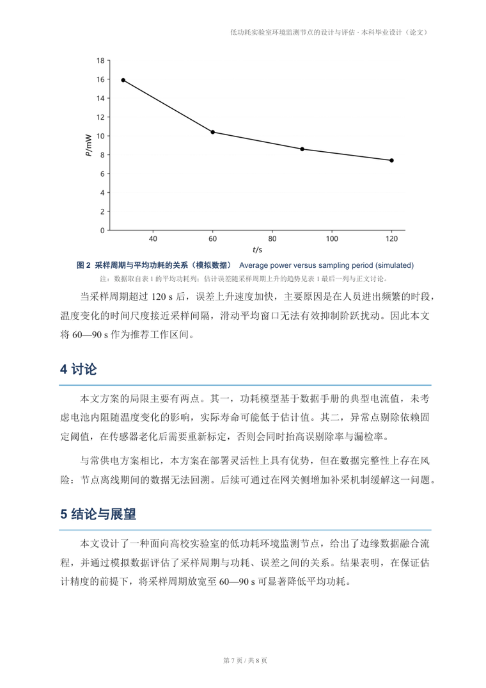
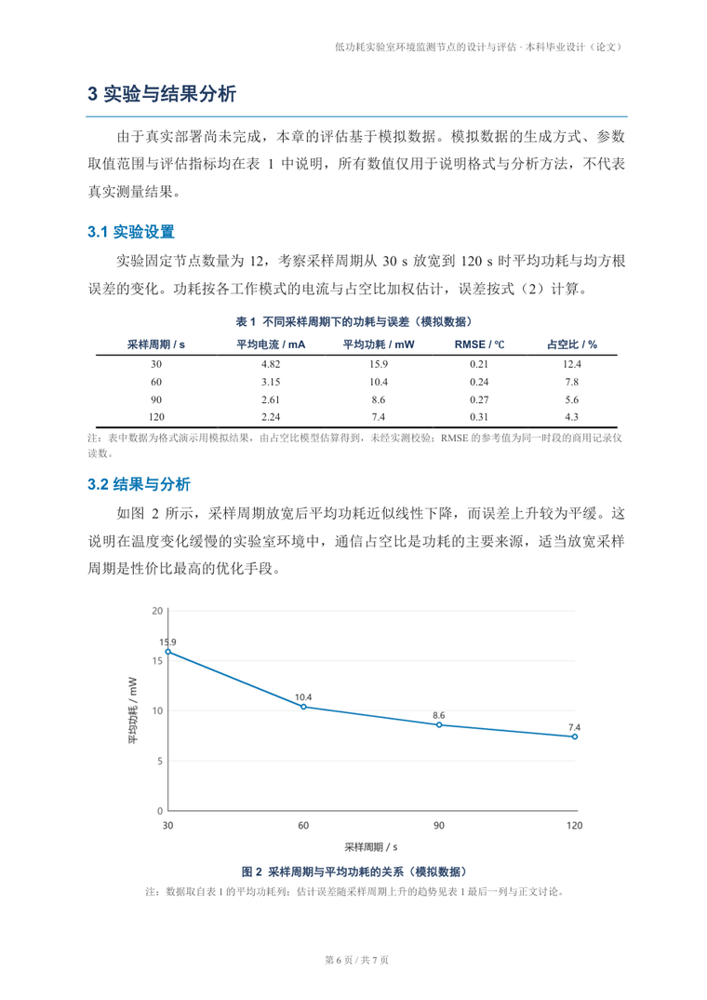

# academic-paper-docx

> Turn a Chinese academic Word formatting spec into a **runnable, verifiable** formatting system.
> You supply content; the scripts guarantee page geometry, fonts, sizes, colors, heading levels,
> three-line tables, figure/table captions, native OMML equations, auto TOC, headers/footers,
> GB/T 7714 references, and a document that opens in Print Layout at 100%.

[](https://github.com/Znk1314/academic-paper-docx/actions/workflows/ci.yml)
[](LICENSE)
[](pyproject.toml)

[中文说明（主文档）](README.md) · [Spec (Chinese)](references/format-spec.md) · [Demo PDF](docs/demo/demo_report.pdf)

The repository root **is** an agent skill (`SKILL.md` lives at the root), so
`git clone <repo> ~/.dsh/skills/academic-paper-docx` (or `~/.codex/skills/`, `~/.claude/skills/`)
makes it available to DSH / Codex / Claude-style agents immediately.

## What it fixes

| Failure mode | Root cause | What this project does |
|---|---|---|
| Chinese fonts silently ignored | `w:asciiTheme` overrides explicit `w:ascii` | theme attributes stripped before writing `rFonts` |
| Indentation done with spaces | breaks when the font changes | `firstLineChars="200"` (true 2-character indent) |
| References pushed off the page | python-docx writes EMU into `w:hanging` (twips expected) | writes the XML directly; `hanging_cm=` helper |
| "Three-line" tables with grid lines | only some `tblBorders` edges declared | all six edges explicit + header `tcBorders` |
| Header row lost across pages | missing `w:tblHeader`, splittable rows | repeat header + `cantSplit` on every row |
| Equations as images | no OMML support | LaTeX subset → OMML, editable in Word |
| TOC typed by hand | not a field | real `TOC \o "1-1"` field, marked dirty |
| Page numbers typed by hand | not a field | `PAGE` / `NUMPAGES` fields |
| Opens in Web Layout | Word rewrites `w:view` on save | re-apply `w:view=print` after the final save |
| Figure/table numbering breaks | numbers hard-coded in text | script owns numbering; renumbering is automatic |

## Preview

Generated entirely from [`examples/demo/content_model.json`](examples/demo/content_model.json) — no manual layout:

| Cover | Abstract | Figure + equation | Three-line table |
|---|---|---|---|
|  |  |  |  |

Full 7-page output: [docs/demo/demo_report.pdf](docs/demo/demo_report.pdf).

## Install

> **In one sentence: drop the whole repository folder (keep the name `academic-paper-docx`) into your agent's skills directory.**
>
> The repository root *is* the skill root — `SKILL.md` sits next to `scripts/`, `examples/` and `references/`.
> Nothing to build, and you never `pip install` this repo (only its Python dependencies). **Do not rename
> the folder** — the skill name comes from the directory name.

| Your agent | skills directory | Final path |
|---|---|---|
| **DSH** (Deepseek Harness) | `~/.dsh/skills/` | `~/.dsh/skills/academic-paper-docx/` |
| **Codex** | `~/.codex/skills/` | `~/.codex/skills/academic-paper-docx/` |
| **Claude** (or any `SKILL.md`-aware agent) | `~/.claude/skills/` | `~/.claude/skills/academic-paper-docx/` |
| Single project only | `<project>/.dsh/skills/` | `<project>/.dsh/skills/academic-paper-docx/` |

The installed layout must look like this (`SKILL.md` at the top of the skill folder):

```text
~/.dsh/skills/academic-paper-docx/
├── SKILL.md          ← what the agent reads
├── scripts/          ← generator + QA
├── examples/         ← content-model samples
├── references/       ← the formatting spec
└── requirements.txt
```

### A. git clone (recommended — `git pull` to upgrade)

```bash
# macOS / Linux
git clone https://github.com/Znk1314/academic-paper-docx ~/.dsh/skills/academic-paper-docx
python3 -m pip install -r ~/.dsh/skills/academic-paper-docx/requirements.txt
```

```powershell
# Windows
git clone https://github.com/Znk1314/academic-paper-docx "$env:USERPROFILE\.dsh\skills\academic-paper-docx"
python -m pip install -r "$env:USERPROFILE\.dsh\skills\academic-paper-docx\requirements.txt"
```

For Codex, swap `/.dsh/skills` for `/.codex/skills`.

### B. Download ZIP (no git)

1. **Code → Download ZIP** on the repository page (or grab the zip attached to a Release);
2. Extract it:
   - a **Release** attachment extracts to `academic-paper-docx/` — use it as is;
   - **Code → Download ZIP** extracts to `academic-paper-docx-main/` (branch suffix) — **rename it to
     `academic-paper-docx`**;
3. Move **that folder** into your skills directory (do not nest it one level deeper; you must end up with
   `academic-paper-docx/SKILL.md`);
4. `python -m pip install -r <that path>/requirements.txt`.

> The folder name *is* the skill name. Keep the `-main` suffix and the agent will list the skill as
> `academic-paper-docx-main`. The installer scripts normalise the name for you.

### C. Installer script (after cloning locally)

```bash
./install.sh codex                 # or dsh / claude / project / custom <dir>
pwsh -File .\install.ps1 -Target codex -Force
```

### Verify

```bash
python ~/.dsh/skills/academic-paper-docx/scripts/apd.py doctor
python ~/.dsh/skills/academic-paper-docx/scripts/apd.py demo -o /tmp/apd-demo
```

Then **restart the agent or start a new session** (skills directories are usually scanned at startup) and
ask for something small, e.g. *"Generate a two-page course report with a three-line table and one equation."*

### Troubleshooting

| Symptom | Fix |
|---|---|
| Skill not listed | Agent not restarted, or the folder is nested twice (`skills/academic-paper-docx/SKILL.md` is the correct depth) |
| Skill shows up as `academic-paper-docx-main` | ZIP extraction kept the branch suffix — rename the folder, then restart |
| Skill loads but commands fail | Missing deps: `python -m pip install -r <dir>/requirements.txt` |
| `python` is older than 3.9 | Use `py -3.12` / your own interpreter; `apd.py doctor` prints the version |

## As a plain tool (no skill install)

```bash
git clone https://github.com/Znk1314/academic-paper-docx && cd academic-paper-docx
python -m pip install -r requirements.txt
python scripts/apd.py doctor                 # environment self-check
python scripts/apd.py demo -o build/demo     # full pipeline on the bundled sample
```

Just want the formatting spec? Read [`references/format-spec.md`](references/format-spec.md) — no dependencies.

## Usage

```bash
# 1) content model -> docx
python scripts/apd.py build work/content.json -o work/report.docx

# 2) update fields + TOC, export PDF, force Print Layout (Windows + Word)
python scripts/apd.py post work/report.docx

# 3) QA + page-by-page preview
python scripts/apd.py qa work/report.docx --pdf work/report.pdf
python scripts/apd.py preview work/report.pdf -o work/preview

# whole pipeline on the bundled example
python scripts/apd.py demo -o build/demo
```

No Word (macOS / Linux): `bash scripts/postprocess.sh work/report.docx`
(LibreOffice export; the document carries `w:updateFields`, so Word/WPS refreshes the TOC on open —
otherwise press `Ctrl+A` then `F9`).

## Format contract

Every value lives in `SPEC` at the top of [`scripts/docx_builder.py`](scripts/docx_builder.py)
and is asserted by the QA script:

| Item | Value |
|---|---|
| Paper / margins | A4 21×29.7 cm; top 2.4 / bottom 2.2 / left 2.6 / right 2.4 cm; header 1.2 / footer 1.0 cm; different first page |
| Body | SimSun + Times New Roman, 12 pt, 1.5 line spacing, 2-char first-line indent, 6 pt after, justified |
| Heading 1 | SimHei + Arial, 16 pt bold `#1F3A5F`, 16/8 pt spacing, 0.75 pt `#0072B2` bottom rule, keep-with-next |
| Heading 2 | SimHei + Arial, 13 pt bold `#0072B2`, 10/4 pt spacing |
| Cover | title 24 pt, subtitle 20 pt, kicker 15 pt, 1.5 pt accent rule, borderless info table |
| Tables | three-line: 1.5 pt top/bottom, 1 pt header rule, no vertical lines, repeated header, unsplittable rows, 9 pt cells |
| Captions | 9.5 pt bold `#1F3A5F` centered; figure captions below, table captions above; notes 8.5 pt `#595959` |
| Equations | OMML, centered, right-aligned `（1）` number via a 1×3 borderless table |
| Lists | no bullets, `（1）（2）（3）` only |
| TOC | `TOC \o "1-1" \h \z \u`, level 1 only; abstract uses a `Front Heading` style (looks like H1, excluded from TOC) |
| Header / footer | 8.5 pt gray, right-aligned `title · type`; 8 pt gray, centered `第 X 页 / 共 Y 页` |
| References | 9 pt, 0.74 cm hanging indent, GB/T 7714, `[n]` auto-numbered |
| View | `w:view=print` + `w:zoom=100%` |

Palette: navy `#1F3A5F`, blue `#0072B2`, orange `#E69F00`, green `#009E73`, ink `#262626`,
gray `#595959`, pale `#EAF2FA`, border `#B4C6E7`.

## QA

`python scripts/apd.py qa report.docx --pdf report.pdf` runs 35 checks
(page geometry, view, three core styles, body indent/spacing/alignment, list form,
table borders and header, caption size/color/numbering, image aspect and width cap,
OMML presence and equation numbering, TOC field, header/footer fields, reference indent,
cross references, font whitelist, blank pages, placeholder residue).
`--strict` promotes warnings to failures for CI gates.

## Testing

```bash
python -m pip install -r requirements-dev.txt
python -m ruff check .
python -m pytest -q     # 81 passed
```

CI: Windows / Linux / macOS × Python 3.9 / 3.12 — lint, unit tests, end-to-end build + QA.

## Known limitations

- Data authenticity is your job; the tool only reminds you with `[待补充/待核实]` and "simulated data" notes.
- Word is the final judge: LibreOffice's OMML/field support is incomplete — verify in Word before delivery.
- Re-skinning colors requires regenerating figures with `make_chart.py` (same palette).
- QA hard-codes the default palette; pass `--spec` when you change it.

## Contributing

See [CONTRIBUTING.md](CONTRIBUTING.md). Two rules matter most: **format parameters live in `SPEC`**,
and **changing a format rule requires updating `qa_check.py` plus tests**.

## License

Code: [MIT](LICENSE). `references/format-spec.md` remains the property of its original author and is
included only as the implementation reference.
Colors follow [Okabe–Ito](https://jfly.uni-koeln.de/color/) (color-vision-deficiency friendly).
