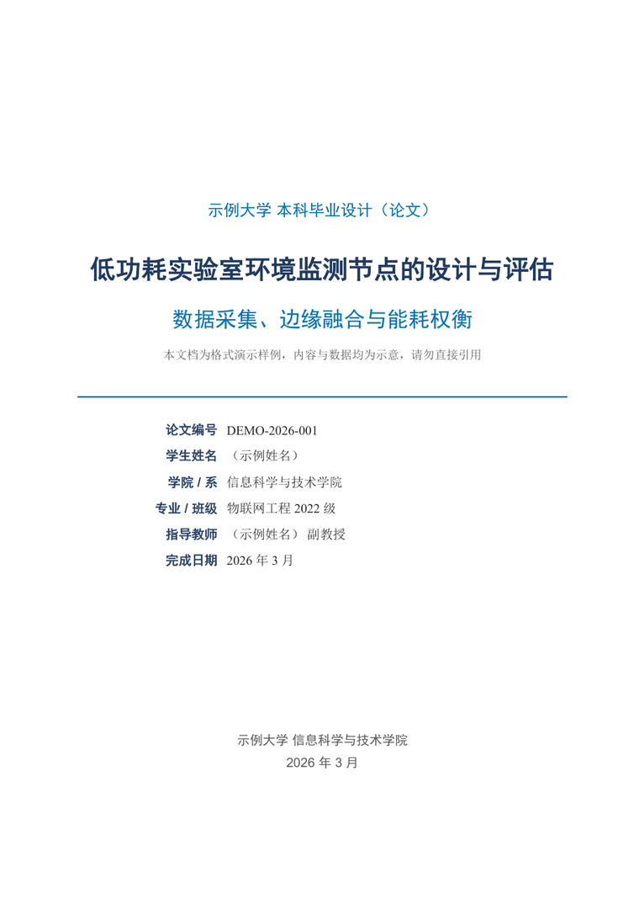
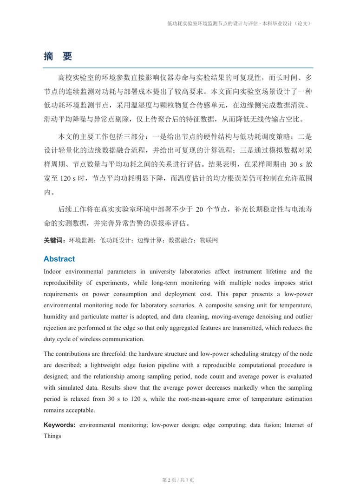
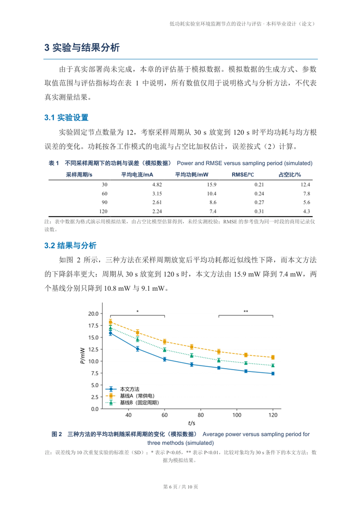
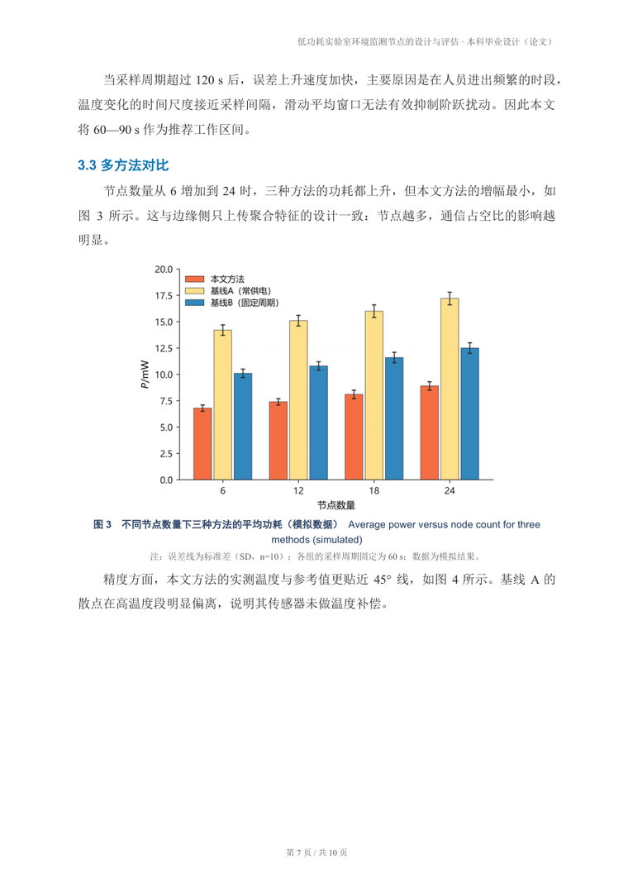
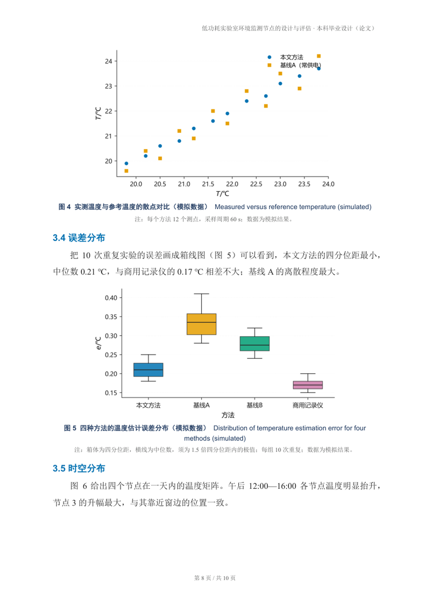
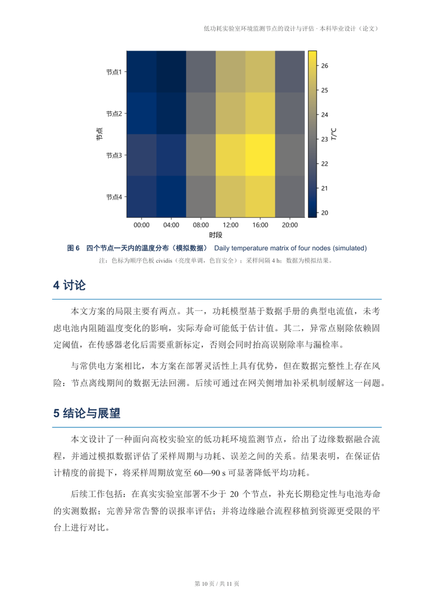
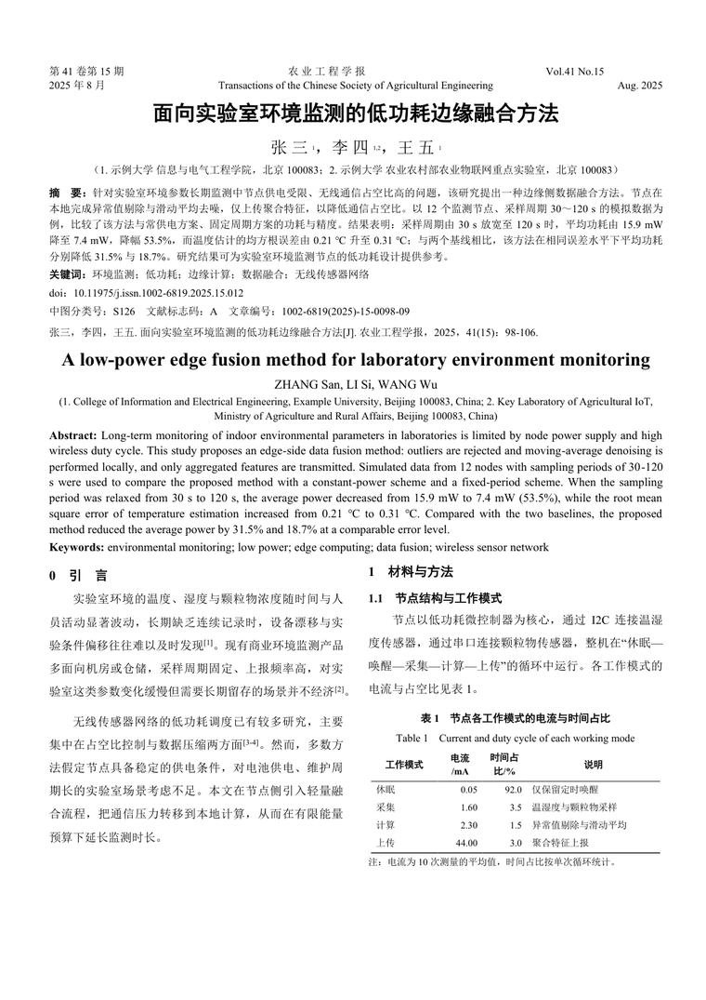

# academic-paper-docx

> 把「学术论文 / 研究报告 Word 排版与生成规范」变成一套**能跑、能验、能交付**的格式系统。
> 你只提供内容，脚本保证页面、字体、字号、配色、标题层级、三线表、图题表题、OMML 公式、
> 自动目录、页眉页脚、参考文献格式、默认页面视图全部正确。

[](https://github.com/Znk1314/academic-paper-docx/actions/workflows/ci.yml)
[](LICENSE)
[](pyproject.toml)
[](scripts/qa_check.py)
[](#安装)

**它同时是一个 agent skill**：仓库根目录就是 skill 根目录（`SKILL.md` 在根上），
`git clone` 到 `~/.dsh/skills/` 或 `~/.codex/skills/` 就能被 agent 直接使用。

[English](README.en.md) · [格式规范全文](references/format-spec.md) · [在线落地页](docs/index.html) · [示例 PDF](docs/demo/demo_report.pdf)

---

## 为什么需要它

让模型「写个 Word」的十种翻车方式，这里逐条固化了修复：

| 常见翻车 | 根因 | 本项目的处理 |
|---|---|---|
| 宋体/黑体不生效 | 只设了 `w:ascii`，样式里还有 `w:asciiTheme` 主题字体覆盖 | 写入前清除 theme 属性 |
| 缩进靠敲空格 | 手动空格换字体就错位 | `firstLineChars=200`（真·2 字符） |
| 参考文献整段跑出页面 | `w:hanging` 单位坑：python-docx 把 EMU 当 twips | 直接写 XML，`hanging_cm` 参数 |
| 三线表变全框线 | `tblBorders` 只改了部分边 | 6 条边全显式声明 + 表头 `tcBorders` |
| 表头跨页丢失 | 缺 `w:tblHeader`；行可拆分 | 表头重复 + 全行 `cantSplit` |
| 公式是图片 | 不支持 OMML | 自写 LaTeX 子集 → OMML，双击可编辑 |
| 目录是手打文本 | 没用域 | 真 `TOC \o "1-2"` 域 + `dirty` 标记 |
| 页码手打「第 3 页」 | 没用域 | `PAGE` / `NUMPAGES` |
| 打开是 Web 版式 | Word 保存会把视图改回 web | 最后一次保存后再写 `w:view=print` |
| 图表编号一改就乱 | 编号写死在正文 | 编号由脚本接管，重排自动连续 |

## 成品预览

全部由 [`examples/demo/content_model.json`](examples/demo/content_model.json) 自动生成，**未做人工排版**：

| 封面 | 摘要 |
|---|---|
|  |  |

| 三线表 + 多系列折线图（3 色 7 点 + 误差线 + 显著性） | 分组柱状图（3 系列 × 4 组） |
|---|---|
|  |  |

| 散点图 + 箱线图（同一页两种图型） | 热图（cividis 顺序色板，色盲安全） |
|---|---|
|  |  |

另有《农业工程学报》期刊模板（`--profile csae`，双栏、黑体标题、楷体图题）：



完整 11 页、6 张图见 [docs/demo/demo_report.pdf](docs/demo/demo_report.pdf)：
柱状（4 类，零基线）、折线（3 系列 × 7 点、SD 误差线、`*`/`**` 显著性）、
分组柱状（3 系列 × 4 组）、散点（2 系列 × 12 点）、箱线（4 组）、热图（cividis 顺序色板）。

## 三种用法：怎么说、怎么切单栏/双栏

这套 skill 有**两套版式**，切换成本只有一行命令或一句话：

| 版式 | 样子 | 适用 | 参数 |
|---|---|---|---|
| **单栏（thesis）** | 封面 + 摘要 + Abstract + 目录 + 正文 12 pt，页脚"第 X 页" | 毕业设计、学位论文、课程报告、研究报告 | `--profile thesis` |
| **双栏（csae）** | 《农业工程学报》版式：双栏 8.66 cm、黑体 18 pt 题名、正文 10 pt、页码在页眉 | 期刊投稿、学术论文 | `--profile csae` |

### 用法一：直接用话告诉 AI（最省事，推荐）

不用记参数，说清楚"给谁投"即可，agent 会按下面的规则选模板：

> 用 academic-paper-docx 把这批数据写成一篇**期刊论文**，按**农业工程学报**格式排版，双栏。

> 帮我做一份**本科毕业设计**（单栏），要有封面、目录、三线表。

### 用法二：显式指定模板（最可控）

```bash
# 双栏期刊稿
python scripts/apd.py build work/paper.json -o work/paper.docx --profile csae

# 单栏学位论文 / 报告
python scripts/apd.py build work/report.json -o work/report.docx --profile thesis
```

模型里也能写死，脚本与 agent 都认：

```jsonc
{ "profile": "csae" }
```

### 用法三：什么都不说（按任务类型自动判定）

`build` 不给 `--profile` 时按下列优先级决定，并打印判定依据：

```
模板：csae（只写了"论文"，默认按期刊稿（双栏））
```

| 优先级 | 线索 | 结果 |
|---|---|---|
| 1 | 命令行 `--profile` | 用指定值 |
| 2 | 模型里 `"profile": "csae" / "thesis"` | 用指定值 |
| 3 | 模型带 `journal` 块（刊名/卷期/doi） | **双栏** |
| 4 | `meta.doc_type` 含 毕业设计 / 学位论文 / 课程报告 / 研究报告 / 开题 / 结题 | **单栏** |
| 5 | `meta.doc_type` 含 期刊 / 学报 / 投稿 / 学术论文 | **双栏** |
| 6 | 只写了"论文" | **双栏**（按期刊稿） |
| 7 | 其它（报告、说明、方案…） | **单栏** |

> 为什么"毕业设计（论文）"要排在"论文"前面？因为中文里它同时含"论文"二字，
> 若先匹配"论文"就会把毕业设计误判成双栏期刊稿。这一条已有单测守着。

### 质检不用再指定

`apd qa` 省略 `--profile` 时会**看文档本身**：正文是双栏就按期刊模板检查（23 项），
单栏就按学位论文模板检查（55 项）。

```bash
python scripts/apd.py qa work/paper.docx            # 自动识别
python scripts/apd.py qa work/paper.docx --profile csae   # 也可强制
```

### 一句话对照

| 你说 | 得到 |
|---|---|
| "写一篇期刊论文 / 学术论文，投农业工程学报" | 双栏 csae |
| "写一篇论文"（没说类型） | 双栏 csae |
| "本科毕业设计 / 学位论文 / 课程报告 / 研究报告" | 单栏 thesis |
| "帮我排个说明文档 / 方案" | 单栏 thesis |

## 三步跑起来（推荐）


```bash
# 1) 装到 agent 的 skills 目录并自动装依赖（Windows）
powershell -ExecutionPolicy Bypass -File install.ps1 -Target dsh
#    macOS / Linux 或手动：git clone 到 ~/.dsh/skills/ 后
#    python -m pip install -r requirements.txt

# 2) 自检（告诉你"能做什么、缺什么"，缺了也不影响核心）
python scripts/apd.py doctor

# 3) 跑一遍完整示例：6 张图 + 三线表 + 公式 + 目录 → docx/PDF/质检
python scripts/apd.py demo -o build/demo
```

不需要 Word、不需要 Origin；中文图内文字用系统的雅黑/黑体/Noto，
没有中文字体时用 `APD_CJK_FONT=<字体名>` 指定即可。

## 环境要求（先看这张表）

**只有 python-docx 与 lxml 是硬性依赖**，其余能力可缺，缺了只少一块功能、不会报错退出：

| 能力 | 需要什么 | 缺了会怎样 |
|---|---|---|
| 生成 .docx（核心） | Python 3.9+、`python-docx`、`lxml` | —— 必需 |
| 出图（`apd figure`） | `matplotlib`、`numpy` | 跳过出图，docx 里可以只放已有图片 |
| 图片分辨率质检 | `Pillow` | 少一项检查 |
| 中文图内文字 | 任一中文字体（雅黑/黑体/Noto Sans CJK/萍方/文泉驿） | 中文显示方框，可用 `APD_CJK_FONT=<字体名>` 指定 |
| 自动更新目录 + 导 PDF | Microsoft Word（Windows）或 LibreOffice | docx 照常生成；打开后按 F9 手动更新目录即可 |
| PDF 逐页预览 / 体检 | `PyMuPDF` | 跳过该功能 |
| 运行测试 | `pytest`、`ruff` | —— 仅开发需要 |

平台：Windows / macOS / Linux 都能生成 docx 与出图；**Word 不是必需项**
（Linux/macOS 用 LibreOffice 或在线打开 Word 也行，目录手动更新一次）。

自检：

```bash
python scripts/apd.py doctor
```

## 安装

> **一句话：把整个仓库文件夹（保持名字 `academic-paper-docx`）放进 agent 的 skills 目录，就装好了。**
>
> 仓库根目录**就是** skill 根目录——`SKILL.md` 在根上，`scripts/`、`examples/`、`references/` 与它同级。
> 不需要编译、不需要 `pip install` 本仓库（只装它的 Python 依赖）。**文件夹名不要改**，技能名取自目录名。

### 放到哪个目录

`~` 指用户主目录（Windows 上是 `C:\Users\<用户名>`）。

| 你用哪个 agent | skills 目录 | 装好后的最终路径 |
|---|---|---|
| **DSH**（Deepseek Harness） | `~/.dsh/skills/` | `~/.dsh/skills/academic-paper-docx/` |
| **Codex** | `~/.codex/skills/` | `~/.codex/skills/academic-paper-docx/` |
| **Claude** 或其它读 `SKILL.md` 的 agent | `~/.claude/skills/` | `~/.claude/skills/academic-paper-docx/` |
| 只给当前项目用 | `<项目>/.dsh/skills/` | `<项目>/.dsh/skills/academic-paper-docx/` |

装好后目录长这样（`SKILL.md` 必须在这一层）：

```text
~/.dsh/skills/academic-paper-docx/
├── SKILL.md          ← agent 读这个文件
├── scripts/          ← 生成与质检脚本
├── examples/         ← 内容模型样例
├── references/       ← 规范全文与排障
└── requirements.txt
```

### 方式 A：git clone（推荐，之后 `git pull` 即可升级）

```powershell
# Windows (PowerShell)
git clone https://github.com/Znk1314/academic-paper-docx "$env:USERPROFILE\.dsh\skills\academic-paper-docx"
python -m pip install -r "$env:USERPROFILE\.dsh\skills\academic-paper-docx\requirements.txt"
```

```bash
# macOS / Linux
git clone https://github.com/Znk1314/academic-paper-docx ~/.dsh/skills/academic-paper-docx
python3 -m pip install -r ~/.dsh/skills/academic-paper-docx/requirements.txt
```

换成 Codex 就把 `\.dsh\skills` 改成 `\.codex\skills`（`~/.codex/skills`）。

### 方式 B：下载 ZIP（不用 git）

1. 仓库页面 → **Code → Download ZIP**（或从 Releases 下载附件 zip）；
2. 解压：
   - **Releases 附件**解开就是 `academic-paper-docx/`，直接用；
   - **Code → Download ZIP** 会解成 `academic-paper-docx-main/`（带分支名）→ **重命名为 `academic-paper-docx`**；
3. **把这个文件夹整个剪切到 skills 目录**（不要再往里套一层，最终要能看到 `academic-paper-docx/SKILL.md`）；
4. 装依赖：`python -m pip install -r <目标路径>\requirements.txt`。

> 目录名就是技能名。留着 `-main` 后缀，agent 里看到的技能会叫 `academic-paper-docx-main`，
> 写法与本文档不一致。用 `install.ps1` / `install.sh` 安装则不用管，脚本会统一成正确名字。

### 方式 C：安装脚本（已在本地 clone 过）

```powershell
pwsh -File .\install.ps1 -Target dsh -Force     # 也支持 codex / claude / project / custom
pwsh -File .\install.ps1 -Target custom -Path D:\my-agent\skills -Link   # 符号链接，改代码立即生效
```

```bash
./install.sh codex          # 或 dsh / claude / project / custom <dir>
LINK=1 ./install.sh codex   # 符号链接
```

脚本会自动排除 `.git`、`__pycache__`、`build/` 等生成物。

### 装完怎么验证

```bash
# 1) 目录正确（能看到 SKILL.md 与 scripts/apd.py）
ls ~/.dsh/skills/academic-paper-docx

# 2) 环境自检（会列出 python-docx / Word / 中文字体等）
python ~/.dsh/skills/academic-paper-docx/scripts/apd.py doctor

# 3) 跑一遍内置示例（图表 → docx → 质检），确认脚本可用
python ~/.dsh/skills/academic-paper-docx/scripts/apd.py demo -o /tmp/apd-demo
```

然后**重启 agent 或新开一个会话**（skills 目录一般在启动时扫描），让它试着做一件小事，例如：

> 用 academic-paper-docx 生成一份课程报告，两页就行，包含一张三线表和一个公式。

agent 应该会读 `SKILL.md` → 写 `content.json` → 调 `scripts/apd.py build`。

### 也可以让 agent 自己装

把下面这段直接发给支持「执行命令 + 访问网络」的 agent：

```text
把 https://github.com/Znk1314/academic-paper-docx 克隆到 ~/.dsh/skills/academic-paper-docx
（若已存在则先备份），然后执行 python -m pip install -r <该目录>/requirements.txt，
最后运行 <该目录>/scripts/apd.py doctor 并把结果告诉我。
```

### 找不到技能 / 装不上

| 现象 | 原因与处理 |
|---|---|
| agent 里没有 `academic-paper-docx` 技能 | 没重启；或目录多套了一层（必须是 `skills/academic-paper-docx/SKILL.md`） |
| 技能名变成 `academic-paper-docx-main` | ZIP 解压带了分支名，把目录重命名成 `academic-paper-docx` 再重启 |
| 技能出现了但一跑就报错 | 依赖没装：`python -m pip install -r <目录>/requirements.txt` |
| `python` 不是 3.9+ | 用 `py -3.12` 或改成你的解释器路径；`apd.py doctor` 会显示版本 |
| Windows 上 `~` 不生效 | PowerShell 用 `$env:USERPROFILE`，cmd 用 `%USERPROFILE%` |

## 当普通工具用（不装成 skill）

```bash
git clone https://github.com/Znk1314/academic-paper-docx
cd academic-paper-docx
python -m pip install -r requirements.txt
python scripts/apd.py doctor                 # 环境自检
python scripts/apd.py demo -o build/demo     # 跑一遍完整示例
```

只想要格式规范手册：直接读 [`references/format-spec.md`](references/format-spec.md)，不需要任何依赖。

## 三步上手（装好之后）

下面的 `scripts/apd.py` 是相对路径，在 skill 目录里执行；不在那个目录时用绝对路径
（例如 `python ~/.dsh/skills/academic-paper-docx/scripts/apd.py ...`）。产物路径随意，建议单独建一个工作目录。

```bash
# 1) 内容模型 → docx
python scripts/apd.py build work/content.json -o work/report.docx

# 2) 更新域与目录、导出 PDF、把视图固定为页面视图（Windows + Word）
python scripts/apd.py post work/report.docx

# 3) 质检 + 文风自检 + 逐页预览
python scripts/apd.py qa work/report.docx --pdf work/report.pdf
python scripts/apd.py tone --docx work/report.docx
python scripts/apd.py preview work/report.pdf -o work/preview
```

一条命令跑完整示例（图表 → docx → PDF → 质检 → 预览）：

```bash
python scripts/apd.py demo -o build/demo
```

没有 Word（macOS / Linux）：`bash scripts/postprocess.sh work/report.docx`（LibreOffice 兜底）。
文档已写入 `w:updateFields`，用 Word/WPS 打开会自动更新目录；如未展开按 `Ctrl+A` → `F9`。

## 格式指标

这些值都写在 [`scripts/docx_builder.py`](scripts/docx_builder.py) 顶部的 `SPEC` 里，并被质检脚本逐条断言：

| 项目 | 值 |
|---|---|
| 纸张 / 页边距 | A4 21×29.7 cm；上 2.4 / 下 2.2 / 左 2.6 / 右 2.4 cm；页眉 1.2 / 页脚 1.0 cm；首页不同 |
| 正文 | 宋体 + Times New Roman，12 pt，1.5 倍行距，首行 2 字符，段后 6 pt，两端对齐 |
| 一级标题 | 黑体 + Arial，16 pt 粗体 `#1F3A5F`，段前 16 / 段后 8 pt，下边框 0.75 pt `#0072B2`，keep-with-next |
| 二级标题 | 黑体 + Arial，13 pt 粗体 `#0072B2`，段前 10 / 段后 4 pt |
| 封面 | 主标题 24 pt、副标题 20 pt、类型行 15 pt、1.5 pt 学术蓝横线、无边框信息表 |
| 三线表 | 顶/底线 1.5 pt，表头线 1 pt，无竖线，表头重复，行不拆分，表内 9 pt |
| 图 / 表题 | 9.5 pt 粗体 `#1F3A5F` 居中；图题在下、表题在上；图注/表注 8.5 pt `#595959` |
| 公式 | OMML 居中，编号 `（1）` 右对齐，1×3 无边框表格定位 |
| 列表 | 不用圆点，统一 `（1）（2）（3）` |
| 目录 | `TOC \o "1-2" \h \z \u`，默认列到二级（可配 `1-3`）；摘要/Abstract 用 `Front Heading`（外观同 H1 但不进目录） |
| 页眉 / 页脚 | 8.5 pt 灰右对齐 `标题 · 类型`；8 pt 灰居中 `第 X 页 / 共 Y 页` |
| 参考文献 | 9 pt，悬挂缩进 0.74 cm，GB/T 7714，自动补 `[n]` |
| 视图 | `w:view=print` + `w:zoom=100%` |

配色：深海军蓝 `#1F3A5F`、学术蓝 `#0072B2`、暖橙 `#E69F00`、学术绿 `#009E73`、
正文 `#262626`、次级 `#595959`、浅底 `#EAF2FA`、淡边框 `#B4C6E7`。

## 架构

```
内容模型 (JSON)                格式库 (SPEC)                   产物
┌──────────────┐    build     ┌──────────────────┐   docx   ┌────────────┐
│ content.json │ ───────────► │ docx_builder.py  │ ───────► │ report.docx │
│  meta        │              │ 页面/样式/封面    │          └─────┬──────┘
│  abstract    │              │ 三线表/图/公式    │                │ Word COM
│  sections[]  │   equation   │ 目录域/页眉页脚   │                ▼
│  references  │ ───────────► │ omml_latex.py    │          ┌────────────┐
└──────────────┘              └──────────────────┘          │ report.pdf │
                                                             └─────┬──────┘
                            ┌──────────────────┐   QA 47 项        │ 逐页渲染
                            │ qa_check.py      │ ◄─────────────────┤
                            └──────────────────┘                   ▼
                                                        preview/page-*.png
                            ┌──────────────────┐   AI 味评分
                            │ ai_tone_check.py │ ◄── 正文文本
                            └──────────────────┘
```

```
academic-paper-docx/
├── SKILL.md                  agent 入口（DSH / Codex / Claude 通用）
├── scripts/
│   ├── apd.py                统一 CLI：doctor / build / post / qa / preview / figure / tone / demo
│   ├── docx_builder.py       格式库 + PaperBuilder API（SPEC 在文件顶部）
│   ├── palette.py            唯一配色源（Okabe-Ito / Tol / Viridis 家族）
│   ├── figures.py            插图渲染（毫米版面 / 1000 dpi / 矢量 / 灰度自检）
│   ├── omml_latex.py         LaTeX 子集 → OMML（零外部依赖）
│   ├── ai_tone_check.py      「AI 味」启发式检测（只报警，不改稿）
│   ├── build_docx.py         内容模型 JSON → docx
│   ├── qa_check.py           47 项规范质检（含配色/精度/分辨率/文风）
│   ├── make_chart.py         旧名兼容入口（内部走 figures.py）
│   ├── render_preview.py     PDF → 逐页 PNG + 空白页/书签体检
│   ├── postprocess.ps1       Word COM：更新域/目录 + PDF + 固定 print 视图
│   ├── postprocess.sh        LibreOffice 兜底
│   └── set_view.py           只改 settings.xml，强制页面视图
├── references/
│   ├── format-spec.md        规范全文（权威）
│   ├── figure-table-standard.md 图表规范（GB/T 7713.2 核对版）
│   ├── palette.md            配色规范（色板/色盲/灰度/语义）
│   ├── anti-ai-academic-zh.md 「AI 味」规则 + 学术豁免清单 + 改写协议
│   ├── checklist.md          交付前人工核对清单
│   └── troubleshooting.md    已知坑与修复
├── examples/
│   ├── minimal/content.json  最小示例（一页，无图）
│   ├── demo/                 完整样例：内容模型 + 图表规格 + 配图
│   └── python_api.py         不用 JSON、直接写 Python 的示例
├── tests/                    152 个 pytest 用例
├── docs/                     落地页 + 截图 + 示例 PDF
└── .github/                  CI / Release / Pages / Issue 模板
```

## 图表与配色

出图统一走 `scripts/figures.py`（matplotlib 后端），配色统一读 `scripts/palette.py`：

```bash
python scripts/apd.py figure work/fig1.json -o work/figs/fig1.png --grayscale
```

- **毫米版面**：`width_mm: "half"` = 75 mm、`"full"` = **155 mm**（= 版心宽），按插入后不缩放设计字号线宽；图宽超版心直接报错。
- **坐标轴**：`量符号/单位`，符号斜体、单位正体；只留左/下轴线；柱图零基线。
- **色板**：默认 Okabe-Ito 8 色（色盲安全）；`jet`/`rainbow` 直接报错；顺序/发散自动选板。
  另有 **9 套主题色卡**（`rose6` / `spectral8` / `minimal6` / `map7` / `medical6` /
  `ocean8` / `material6` / `bluepink10` / `medical2_6`），`--palette` 指定后自动取
  "安全子集"并打印红绿色盲距离与灰度差；色卡也可直接当热图色图用。
  `python scripts/apd.py palette` 查看判定。
- **冗余编码**：每个系列自动配"颜色 + 线型 + 标记"，黑白打印与色觉障碍都能读。
- **分辨率**：线条图默认 1000 dpi，可同时输出 PDF 矢量；`--grayscale` 出灰度版自检。
- **表格**：`columns` 列元信息自动生成"量/单位"表头、按列精度、右对齐、空缺 `—`、`^{a}` 上标。

规范与自查清单：[references/figure-table-standard.md](references/figure-table-standard.md)、
[references/palette.md](references/palette.md)。

## 内容模型

```jsonc
{
  "meta": {
    "org": "示例大学", "doc_type": "本科毕业设计（论文）",
    "title": "标题", "subtitle": "副标题",
    "info": [["论文编号", "…"], ["指导教师", "…"]],
    "college": "学院", "date": "2026 年 3 月", "header_type": "本科毕业设计（论文）"
  },
  "abstract":    { "heading": "摘　要", "paragraphs": ["…"], "keywords": ["…"] },
  "abstract_en": { "heading": "Abstract", "paragraphs": ["…"], "keywords": ["…"] },
  "toc": true,
  "sections": [
    { "level": 1, "text": "1 引言" },
    { "type": "p", "text": "正文段落…" },
    { "type": "list", "items": ["要点一", "要点二"] },
    { "type": "table", "caption": "示例表", "headers": ["列1", "列2"],
      "rows": [["1", "2"]], "widths": [7, 8.5], "note": "注：示例数据。" },
    { "type": "figure", "path": "figs/fig1.png", "caption": "示例图", "width_cm": 14 },
    { "type": "equation", "latex": "\\hat{x} = \\frac{1}{N}\\sum_{i=1}^{N} x_i" },
    { "type": "callout", "title": "说明", "text": "…" }   // 默认无框，box:true 才有底色
  ],
  "references": ["作者. 题名[J]. 刊名, 2020, 1(2): 3-4."]
}
```

块类型：`h1`/`h2`（也可用 `level`）、`p`、`list`、`table`、`figure`、`equation`、
`callout`、`pagebreak`。字段细节见 [SKILL.md](SKILL.md#2-先写内容模型核心步骤)
与 [examples/minimal/content.json](examples/minimal/content.json)。

换配色/字号用 `--spec`，质检要带同一份（否则颜色断言会 FAIL）：

```bash
python scripts/apd.py build work/content.json -o work/report.docx --spec work/spec.json
python scripts/apd.py qa work/report.docx --spec work/spec.json
```

## 公式

`equation.latex` 支持 LaTeX 子集，转换结果是真的 Word 公式（`m:oMath`），双击即可编辑：

```
上下标 x_i  x^2  x_i^2       分式 \frac{a}{b}        根式 \sqrt{x}  \sqrt[n]{x}
求和/积分 \sum_{i=1}^{n}  \int_0^T      括号 \left( ... \right)
重音 \hat{x} \bar{x} \tilde{x} \vec{x}   正体 \mathrm{RMSE}  \text{中文单位}
希腊字母 \alpha \beta \theta \Delta \omega     运算符 \times \le \approx \pm \infty \to
```

## 质检

```text
[表格]
    OK   数据表为三线表（顶/底线 1.5pt、表头线 1pt、无竖线）
    OK   表格统计：三线表 1 个 / 无边框表 3 个
[图表]
    OK   图题 / 表题：9.5 pt 加粗 #1F3A5F
    OK   图编号从 1 连续不跳号
[图片]
    OK   图片等比缩放且不超版心宽度
    OK   图片与图题同页（keep_with_next）
[公式]
    OK   公式为 Word 原生 OMML（可编辑）
    OK   公式编号连续、位于右侧单元格
...
==============================================================================
通过 47 项，警告 1 项，失败 0 项
结论：符合规范。
```

47 项覆盖：页面几何、默认视图、三个核心样式、正文缩进/行距/对齐、列表形态、
三线表边框与表头、图表题字号/颜色/编号连续性、图片等比与宽度上限、OMML 与编号、
TOC 域、页眉页脚域、参考文献缩进、交叉引用、字体白名单、空白页、占位符残留、文风提示。
`--strict` 把 WARN 也当失败，适合 CI 门禁。

## 文风：按 academic-humanizer 的逻辑改稿

排版对完之后，内容本身还可能一眼是模型写的。这一层**不自研**，整套采用
[AIScientists-Dev/academic-humanizer](https://github.com/AIScientists-Dev/academic-humanizer)
（MIT，2.9k★；上游又基于 [blader/humanizer](https://github.com/blader/humanizer) 与 ARMS），
被多家媒体（含 Nature 相关报道）讨论过。

一条原则：**没有动词可以强过它的证据。**

| 层 | 内容 |
|---|---|
| Layer 1 | 通用 AI 痕迹（意义拔高、宣传词、无源权威、长句堆砌、破折号…） |
| Layer 2 | 学术 AI 痕迹 2.1–2.11（过度断言动词、显著性炒作、新颖性填充、贡献清单套话、模糊限定…） |
| Layer 3 | **必须保留**：有证据的模糊限制、被动语态、"我们"、术语公式；**数字与引用一字不改** |
| Layer 4 | 主张-证据纪律（缺证据→补指针或降调；动词强于证据→降级；量级模糊→区间+口径） |
| Layer 5 | 语体与场合匹配 |
| Layer 6 | 基金本子模式（NSF/NIH：保留愿景，查"主张 ↔ 可行性"） |

流程也是上游的：**Read → Audit → Rewrite → Report**。

```bash
python scripts/apd.py tone --docx work/report.docx            # 审计：两分数 + 命中清单
python scripts/apd.py tone --docx work/report.docx --audit    # 只要清单（层/编号/位置/改法）
python scripts/apd.py tone --json work/content.json --max-score 40   # CI 门禁

# 基金本子（Layer 6）：NSF/NIH 结构 + aims 质量 + 主张↔可行性
python scripts/apd.py tone --text examples/proposal/aims_bad.md --mode proposal
```

Layer 6 检查项：P1 结构缺失、P2 aims 数量、P3 方法当目标、P4 多米诺依赖、
P5 雄心缺可行性、P6 中心假设含糊、P7 Broader Impacts 模板化。示例见
[examples/proposal/](examples/proposal/)（`aims_bad.md` 会报 P3/P5/P6，`aims_good.md` 通过）。

两个分数（对应层）：

| 分数 | 含义 |
|---|---|
| `tells_score` | AI 痕迹密度（Layer 1 + 2） |
| `claims_score` | 主张强于证据的程度（Layer 4） |

实测（仓库自带样例）：

| 文本 | AI 痕迹 | 主张-证据 |
|---|---|---|
| `examples/demo/content_model.json`（按规范写的正文） | 0（干净） | 0（干净） |
| 上游 before 风格的 AI 套话（随着…、首次、广泛实验、证明优于…） | 100（重） | 56（明显） |

**它不是"AI 检测器"**：分数高不等于 AI 写的（模板化公文、翻译腔同样高分），
分数低也不等于合格（真问题常在论证与数据）。它只负责审计与定位，改稿由人或 agent 完成，
且**不许改数字、公式、引用**，**不许把有证据的模糊限制改成确定结论**。

## 跨平台

| 环境 | docx | 更新目录/域 | 导出 PDF | 说明 |
|---|---|---|---|---|
| Windows + Microsoft Word | ✅ | ✅ `postprocess.ps1` | ✅ | 推荐路径，能力最完整 |
| Windows + WPS | ✅ | 打开时更新 | 手动 | TOC 域兼容 |
| macOS / Linux + LibreOffice | ✅ | 打开时更新 | ✅ `postprocess.sh` | 脚本不更新域 |
| 纯 Python | ✅ | — | — | 只生成 docx 也能用 |

## 测试

```bash
python -m pip install -r requirements-dev.txt
python -m ruff check .
python -m pytest -q      # 104 passed
```

用例覆盖：页面几何、三个核心样式、三线表边框、表头重复、图片等比与宽度限制、
OMML 结构、公式编号连续性、悬挂缩进单位（历史 bug 回归）、默认视图、
`set_view.py` 只改 `settings.xml`、质检的 FAIL/WARN 判定、图表尺寸与配色、
CLI 子命令、`SKILL.md` frontmatter、`.ps1` 必须带 UTF-8 BOM。

CI：Windows / Linux / macOS × Python 3.9 / 3.12，跑 lint + 单测 + 端到端构建与质检。

## 已知限制

- **文档真实性靠人**：脚本不会替你判断数据是否虚构，只用 `[待补充/待核实]` 与"模拟数据"标注来提醒。
- **Word 是最终裁判**：LibreOffice 对 OMML 与域的支持不完整，交付前建议用 Word 打开核对。
- **换配色改一处**：图与文档都读 `scripts/palette.py`；改色板后重跑 `figures.py` 出图即可。
- **不自动生成论文内容**：这是排版工具，内容仍然要你（或你的 agent）写。
- 质检里颜色/字号断言写死默认调色板，换肤后必须带 `--spec`。

## 贡献

见 [CONTRIBUTING.md](CONTRIBUTING.md)。最重要的两条：**格式参数集中在 `SPEC`**、
**改格式必须同步改 `qa_check.py` 与 `tests/`**。

## 致谢与许可

- 代码：[MIT](LICENSE)。
- `references/format-spec.md` 是排版规范的原始文档，著作权归原作者，仓库内仅作实现参照。
- 配色采用 [Okabe–Ito](https://jfly.uni-koeln.de/color/) 色盲友好方案。
- 依赖：[python-docx](https://python-docx.readthedocs.io/)、[Pillow](https://python-pillow.org/)、[PyMuPDF](https://pymupdf.readthedocs.io/)。

> 发布到自己的账号时，请把文中 `OWNER` 替换成 GitHub 用户名，步骤见
> [docs/publishing.md](docs/publishing.md)。
